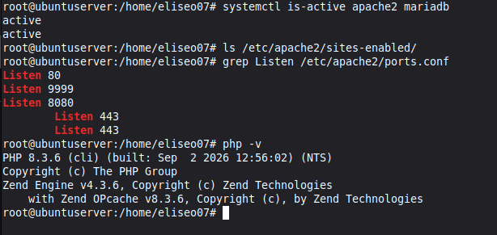
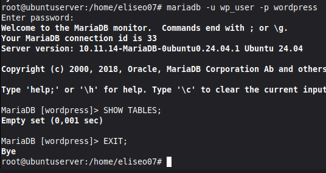
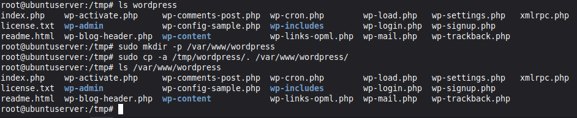
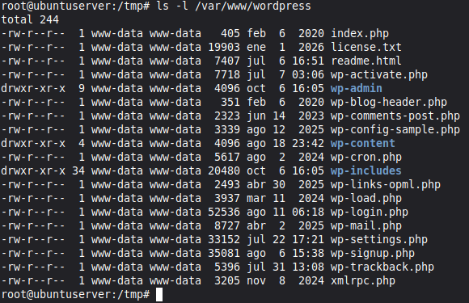
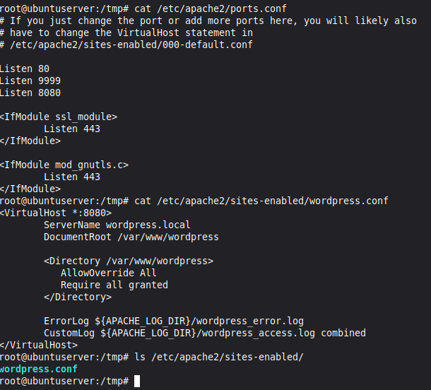
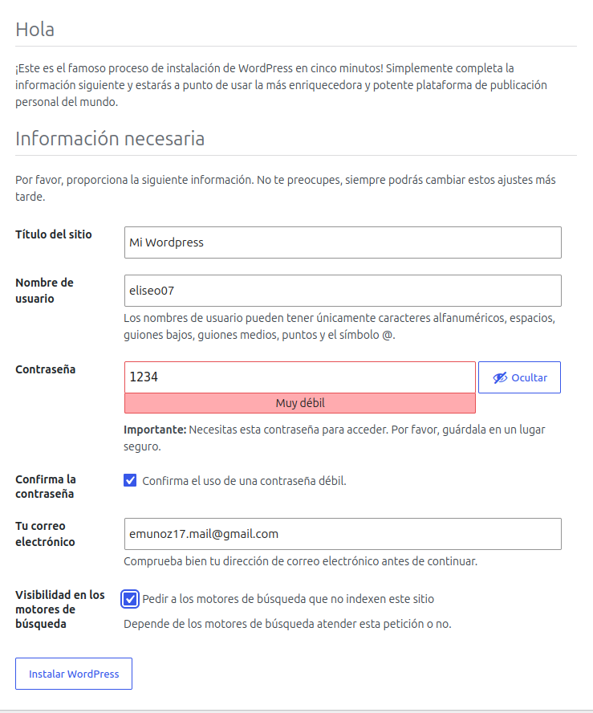
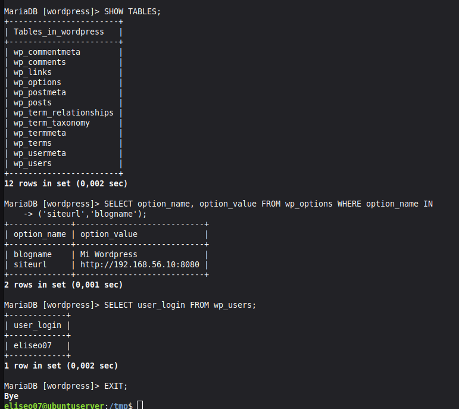
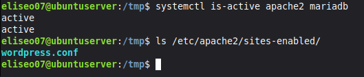

# Instalación WordPress

Eliseo Muñoz Hernández | 2 CFGM de SMX (vesprada)

AWE

Fecha: 22-10-26

# Índice

1. [Compruebo el punto de partida](#1-compruebo-el-punto-de-partida)
1. [Creo la base de datos y el usuario](#2-creo-la-base-de-datos-y-el-usuario)
1. [Descargo WordPress y lo coloco en su carpeta](#3-descargo-wordpress-y-lo-coloco-en-su-carpeta)
1. [Propietario y permisos](#4-propietario-y-permisos)
1. [Creo el VirtualHost de WordPress](#5-creo-el-virtualhost-de-wordpress)
1. [Instalación desde el navegador](#6-instalación-desde-el-navegador)
1. [Dónde ha guardado WordPress cada cosa](#7-dónde-ha-guardado-wordpress-cada-cosa)
1. [Primera entrada e imagen: ficheros frente a base de datos](#8-primera-entrada-e-imagen-ficheros-frente-a-base-de-datos)
1. [Comprobación final](#9-comprobación-final)

---

## 1. Compruebo el punto de partida

Lo primero es comprobar que el LAMP funciona y apuntar qué sitios tengo. Ejecuto:

```bash
systemctl is-active apache2 mariadb
```

```bash
php -v
```

```bash
ls /etc/apache2/sites-enabled/
```

```bash
grep Listen /etc/apache2/ports.conf
```



En la captura se ve que apache2 y mariadb están activos, y también la versión de PHP que tengo instalada. Además, no tengo ningún sitio habilitado. Sobre los puertos, el 8080 ya lo tenía abierto de antes, lo habilité antes de que la guía lo pidiera.

### 1.1 ¿Qué sitios tienes habilitados y en qué puertos escucha Apache? ¿Qué puerto vas a usar para WordPress y por qué no el 80?

No tengo ni un solo sitio habilitado, y Apache escucha por los puertos:

1. Puerto 80.
1. Puerto 9999.
1. Puerto 8080.

Además, en `ports.conf` aparece el 443 de HTTPS, aunque solo se usa si el módulo SSL está activado.

Voy a usar el 8080 para WordPress porque así lo pide la guía. Como no tengo ningún sitio habilitado, el puerto 80 está libre y podría usarlo, pero así WordPress queda en su propio puerto y no me da problemas con los demás sitios.

## 2. Creo la base de datos y el usuario

Para crear la base de datos que usará WordPress, y también un usuario con permiso SOLO sobre ella... primero tengo que entrar en MariaDB.

```bash
sudo mariadb
```

### 2.1 Creo la base de datos

```sql
CREATE DATABASE wordpress CHARACTER SET utf8mb4 COLLATE utf8mb4_unicode_ci;
```

Creo una base de datos llamada `wordpress`, donde WordPress guardará todas sus tablas. Mejor que tenga la suya propia que compartirla con otras aplicaciones, así los datos quedan separados y es más fácil hacer copias de seguridad. Con `utf8mb4` acepta tildes, la ñ y emojis.

### 2.2 Creo el usuario

```sql
CREATE USER 'wp_user'@'localhost' IDENTIFIED BY '********';
```

Creo el usuario `wp_user`, con el que WordPress se conectará a MariaDB. El `@'localhost'` hace que solo pueda conectarse desde la propia máquina, y como WordPress y MariaDB están en el mismo servidor, no necesita más. La contraseña no la escribo aquí por seguridad.

### 2.3 Le doy permiso solo sobre su base de datos

```sql
GRANT ALL PRIVILEGES ON wordpress.* TO 'wp_user'@'localhost';
```

Un usuario recién creado no puede hacer nada, así que le doy todos los permisos, pero solo sobre la base `wordpress`.

### 2.4 Aplico los cambios y salgo

```sql
FLUSH PRIVILEGES;
```

```sql
EXIT;
```

### 2.5 Compruebo que el usuario funciona

Antes de seguir, compruebo que el usuario se ha creado bien y puede entrar.

```bash
mariadb -u wp_user -p wordpress
```

Una vez dentro:

```sql
SHOW TABLES;
```

Debe responder `Empty set`. Eso significa que el usuario puede entrar y ver su base de datos, pero todavía no tiene tablas.



### 2.6 ¿Por qué creamos wp_user en lugar de usar root?

Porque `root` tiene control total sobre todo MariaDB. Si WordPress se viera comprometido, el atacante tendría ese poder. Con `wp_user`, el daño se queda limitado a la base de datos de WordPress.

### 2.7 ¿Qué significa wordpress.* en la orden GRANT?

Indica a qué se aplican los permisos: `wordpress` es la base de datos y `*` significa "todas sus tablas". Así `wp_user` tiene todos los permisos solo dentro de la base `wordpress` y ninguno sobre las demás.

## 3. Descargo WordPress y lo coloco en su carpeta

Ahora toca descargar WordPress. Lo bajo de la web oficial y lo descomprimo, pero no directamente en su sitio definitivo, sino en una carpeta temporal. Cuando compruebo que está todo bien, lo muevo a donde tiene que ir.

### 3.1 Descargo y descomprimo

Primero me meto en `/tmp`, que es una carpeta para cosas temporales (lo que descargue aquí es solo de paso, no quiero dejar el comprimido tirado por el servidor):

```bash
cd /tmp
```

Descargo la última versión desde la web oficial de WordPress:

```bash
wget https://wordpress.org/latest.tar.gz
```

`wget` descarga ficheros desde la terminal, que es lo que necesito porque el servidor no tiene interfaz gráfica.

El fichero viene comprimido (`.tar.gz`), así que lo descomprimo:

```bash
tar -xzf latest.tar.gz
```

Para comprobar que se ha descomprimido bien, miro qué hay dentro:

```bash
ls wordpress
```



### 3.2 Lo copio a su carpeta definitiva

Apache sirve las webs desde `/var/www/`, así que WordPress tiene que acabar ahí. Creo su carpeta:

```bash
sudo mkdir -p /var/www/wordpress
```

Y copio todo el contenido:

```bash
sudo cp -a /tmp/wordpress/. /var/www/wordpress/
```

El punto del final de `/tmp/wordpress/.` hace que se copie el **contenido** de la carpeta y no la carpeta entera. Sin él me quedaría `/var/www/wordpress/wordpress/` y Apache no encontraría nada.

Compruebo que ha salido bien:

```bash
ls /var/www/wordpress
```



### 3.3 Qué hay dentro

Las carpetas que más me van a importar son estas:

| Carpeta | Para qué sirve |
|---------|----------------|
| `wp-admin` | El panel de administración |
| `wp-includes` | El núcleo de WordPress, esto no se toca |
| `wp-content` | Temas, plugins e imágenes subidas. Es lo único que voy a personalizar |

### 3.4 ¿Qué carpeta guarda los temas, plugins e imágenes subidas?

`wp-content`.

### 3.5 ¿Por qué colocamos WordPress en su propia carpeta y no dentro de la de otro sitio?

Porque cada sitio tiene su propio `DocumentRoot`. Si lo metiera dentro de la carpeta de otro, mezclaría los ficheros y podría estropear algo que ya funciona. Así cada web va por su lado y es más fácil de mantener.

## 4. Propietario y permisos

Apache no se ejecuta con mi usuario, sino con uno propio del sistema llamado `www-data`. Si los ficheros no son suyos, WordPress no podrá escribir nada: ni crear su configuración ni guardar las imágenes que suba.

### 4.1 Cambio el propietario

```bash
sudo chown -R www-data:www-data /var/www/wordpress
```

`chown` cambia el propietario de un fichero. Con `-R` lo hace de forma recursiva, o sea, en la carpeta y en todo lo que hay dentro. Lo de `www-data:www-data` es `usuario:grupo`.

### 4.2 Ajusto los permisos

Después doy permisos distintos a las carpetas y a los ficheros. Empiezo por las carpetas:

```bash
sudo find /var/www/wordpress -type d -exec chmod 755 {} \;
```

Y ahora los ficheros:

```bash
sudo find /var/www/wordpress -type f -exec chmod 644 {} \;
```

Con `-type d` el comando solo afecta a las carpetas y con `-type f` solo a los ficheros. Las carpetas necesitan el 755 para que se pueda entrar en ellas, y a los ficheros les basta el 644 porque PHP los lee, no los ejecuta.

### 4.3 Compruebo que ha salido bien

```bash
ls -l /var/www/wordpress
```

Con `-l` se ve la lista larga, y ahí aparecen el propietario, el grupo y los permisos de cada cosa. Deberían salir `www-data www-data` en todo, `drwxr-xr-x` en las carpetas (755) y `-rw-r--r--` en los ficheros (644).


### 4.4 ¿Qué pasaría si el propietario fuera root?

Que Apache (que corre como `www-data`) no podría escribir en la carpeta. WordPress no podría crear el `wp-config.php` ni guardar las imágenes subidas, y la instalación o las subidas darían error.

### 4.5 ¿Por qué no se usa nunca 777?

Porque el 777 da permiso de lectura, escritura y ejecución a absolutamente todos los usuarios del sistema. Cualquiera podría modificar o borrar los ficheros, y si alguien se colara por otro servicio, podría meter código malicioso en la web. Con 755 y 644 el único que puede escribir es el propietario.

## 5. Creo el VirtualHost de WordPress

Ahora hay que decirle a Apache que tiene una web nueva. WordPress va a tener su propio virtualhost en el puerto 8080, igual que hice con el 9999 en la práctica anterior, para no tocar los demás sitios.

### 5.1 Abro el puerto 8080

Apache solo escucha en los puertos que le digo, así que lo primero es añadir el 8080 al fichero de puertos:

```bash
sudo nano /etc/apache2/ports.conf
```

Dentro, añado una línea `Listen 8080` debajo de las que ya hay. No borro ninguna, porque si quito alguna, el sitio que la usa dejaría de funcionar. Queda así:

```apache
Listen 80
Listen 9999
Listen 8080
```

(Como ya dije en el apartado 1, este puerto lo tenía habilitado de antes, pero lo explico igualmente.)



### 5.2 Creo el fichero del sitio

Cada sitio de Apache tiene su propio fichero de configuración en `sites-available`. Creo el de WordPress:

```bash
sudo nano /etc/apache2/sites-available/wordpress.conf
```

Y escribo esto dentro:

```apache
<VirtualHost *:8080>
    ServerName wordpress.local
    DocumentRoot /var/www/wordpress
    <Directory /var/www/wordpress>
        AllowOverride All
        Require all granted
    </Directory>
    ErrorLog ${APACHE_LOG_DIR}/wordpress_error.log
    CustomLog ${APACHE_LOG_DIR}/wordpress_access.log combined
</VirtualHost>
```

### 5.3 Activo el sitio

Crear el fichero no basta, hay que activarlo. Primero activo el módulo `rewrite`, que WordPress necesita para los enlaces permanentes:

```bash
sudo a2enmod rewrite
```

Después activo el sitio:

```bash
sudo a2ensite wordpress.conf
```

`a2ensite` crea un enlace del fichero de `sites-available` a `sites-enabled`, y Apache solo carga los sitios que están en `sites-enabled`.

Antes de reiniciar, compruebo que no me he equivocado escribiendo la configuración:

```bash
sudo apachectl configtest
```

Debe responder `Syntax OK`. Lo hago antes de reiniciar porque, si hay un error y reinicio igualmente, Apache puede no arrancar y se caerían también los sitios anteriores.

Y reinicio Apache para que cargue todo:

```bash
sudo systemctl restart apache2
```

### 5.4 Compruebo los sitios habilitados

```bash
ls /etc/apache2/sites-enabled/
```

Tienen que salir todos los sitios anteriores y además `wordpress.conf`. No he ejecutado ningún `a2dissite`, así que ninguno debería haber desaparecido.

### 5.5 ¿Por qué no ha hecho falta tocar ninguno de los sitios anteriores?

Porque cada sitio tiene su propio fichero de configuración y su propio puerto. WordPress tiene el suyo (`wordpress.conf`, puerto 8080) y Apache los gestiona por separado, así que añadir uno nuevo no afecta a los que ya existen.

### 5.6 ¿Qué dos cosas distinguen a este sitio de los demás?

El puerto (8080) y la carpeta de la que sirve los ficheros (`/var/www/wordpress`).

## 6. Instalación desde el navegador

Hasta ahora todo lo he hecho por terminal, pero este paso es distinto: el instalador de WordPress es una página web, así que lo hago desde el navegador de mi máquina anfitrión (no desde la MV, que no tiene interfaz gráfica). Para entrar necesito la IP de la máquina virtual, que saco con:

```bash
ip a
```

Busco la IP de la interfaz de red (algo tipo `192.168.x.x`) y escribo en el navegador:

```
http://IP_DE_MI_VM:8080
```

El asistente tiene varias pantallas:

1. Elegir idioma: Español.
1. Pantalla de bienvenida: pulso el botón para empezar.
1. Datos de la base de datos (explicados abajo).
1. Pulso el botón de iniciar la instalación.
1. Datos del sitio (explicados abajo).
1. Pantalla de éxito: inicio sesión con el administrador que acabo de crear y llego al Escritorio de WordPress.

### 6.1 Datos de la base de datos

Aquí le digo a WordPress cómo conectarse a la base de datos que creé en el apartado 2:

| Campo | Qué escribo |
|-------|-------------|
| Nombre de la base de datos | `wordpress` |
| Nombre de usuario | `wp_user` |
| Contraseña | `********` |
| Servidor de la base de datos | `localhost` |
| Prefijo de tablas | `wp_` |

En esta parte no hice captura.

### 6.2 Datos del sitio

Ahora toca configurar la web en sí y crear el usuario administrador de WordPress:

| Campo | Qué escribo |
|-------|-------------|
| Título del sitio | El que quiera |
| Nombre de usuario | Uno mío (no `admin`) |
| Contraseña | Una segura |
| Correo electrónico | `alumno@example.com` |
| Visibilidad en buscadores | Marco "Disuadir a los motores de búsqueda" |

No uso `admin` como nombre de usuario porque es el primero que prueban los bots al intentar entrar. Marco lo de los buscadores porque es un servidor de pruebas y no quiero que Google lo indexe.



### 6.3 Entro al Escritorio

Al terminar, inicio sesión con el administrador que acabo de crear y llego al Escritorio de WordPress, que es el panel desde donde se gestiona toda la web:


### 6.4 ¿Qué diferencia hay entre wp_user y el usuario administrador de WordPress? ¿Dónde vive cada uno?

`wp_user` es el usuario de **MariaDB**: lo usa WordPress para conectarse a la base de datos, y vive en el sistema de usuarios de MariaDB. El administrador es un usuario **de la web**: lo uso yo para entrar al panel de WordPress, y vive dentro de la base de datos `wordpress`, en la tabla `wp_users`. Uno sirve para que WordPress hable con la base de datos y el otro para que yo gestione la web.

## 7. Dónde ha guardado WordPress cada cosa

Ahora que está instalado, quiero ver dónde ha puesto cada cosa. Una parte está en un fichero de configuración y otra en las tablas de la base de datos.

### 7.1 El fichero de configuración

Durante la instalación, WordPress ha creado un fichero llamado `wp-config.php` con los datos de conexión que escribí en el asistente. Lo miro, pero **sin enseñar la contraseña**, así que filtro solo las líneas que me interesan:

```bash
sudo grep -E "DB_NAME|DB_USER|DB_HOST" /var/www/wordpress/wp-config.php
```

`grep -E` busca las líneas que contengan alguna de esas tres palabras. Así veo el nombre de la base de datos, el usuario y el servidor, pero no sale `DB_PASSWORD`. No uso `cat` porque mostraría el fichero entero, contraseña incluida.

Como ese fichero tiene la contraseña de la base de datos, conviene que otros usuarios del sistema no puedan leerlo:

```bash
sudo chmod 640 /var/www/wordpress/wp-config.php
```

El 640 significa que el propietario puede leer y escribir, el grupo solo leer, y el resto no puede hacer nada. Compruebo que se ha aplicado:

```bash
ls -l /var/www/wordpress/wp-config.php
```

Tiene que salir `-rw-r-----`.

### 7.2 Las tablas de la base de datos

Ahora entro a la base de datos con el usuario `wp_user` para ver lo que ha creado el asistente:

```bash
mariadb -u wp_user -p wordpress
```

Una vez dentro, listo las tablas (antes estaba vacía, así que las ha creado la instalación):

```sql
SHOW TABLES;
```

Miro los ajustes del sitio, que se guardan en `wp_options`:

```sql
SELECT option_name, option_value FROM wp_options WHERE option_name IN ('siteurl','blogname');
```

Y los usuarios de WordPress, que están en `wp_users`:

```sql
SELECT user_login FROM wp_users;
```

```sql
EXIT;
```



### 7.3 ¿Qué valor tiene siteurl? Relaciónalo con el aviso del apartado 6.

Tiene la dirección con la que instalé WordPress, es decir, `http://IP_DE_MI_VM:8080`. Es justo lo que avisaba la guía en el apartado 6: WordPress guarda esa dirección en la base de datos y siempre redirige a ella. Si entrara por otra dirección distinta, me mandaría de vuelta a esta.

### 7.4 ¿En qué tabla está el administrador que creaste?

En `wp_users`.

## 8. Primera entrada e imagen: ficheros frente a base de datos

Quiero comprobar que WordPress no guarda todo en el mismo sitio. Para verlo, creo una entrada y subo una imagen desde el Escritorio, en el navegador de mi máquina anfitrión.

### 8.1 Creo la entrada y subo la imagen

1. Voy a **Entradas → Añadir nueva**.
1. Pongo de título "Hola desde mi WordPress", escribo una frase y pulso **Publicar**.
1. Voy a **Medios** y subo una imagen pequeña (menos de 2 MB).

### 8.2 Miro dónde ha acabado cada cosa

Primero, la entrada. Entro a la base de datos:

```bash
mariadb -u wp_user -p wordpress
```

Y consulto las últimas filas de la tabla de entradas:

```sql
SELECT ID, post_title, post_type, post_status FROM wp_posts ORDER BY ID DESC LIMIT 5;
```

Con `ORDER BY ID DESC LIMIT 5` veo solo las cinco últimas filas, que son las que acabo de crear. Mi entrada sale como una fila, y la imagen también, con el tipo `attachment`.

```sql
EXIT;
```

Después miro qué hay en la carpeta de subidas:

```bash
ls -R /var/www/wordpress/wp-content/uploads
```

Con `-R` lista también el contenido de las subcarpetas. WordPress organiza las imágenes por año y mes, y ahí está mi imagen, junto con varias copias de distintos tamaños que genera automáticamente.

### 8.3 ¿Qué se guarda en la base de datos y qué en ficheros?

En la **base de datos** se guarda el contenido y los ajustes: entradas, páginas, usuarios, comentarios y configuración del sitio. En **ficheros** se guarda el programa de WordPress, los temas, los plugins y las imágenes subidas (en `wp-content/uploads`). De la imagen, el fichero está en la carpeta, pero sus datos (título, ruta, tipo) están como una fila `attachment` en la base de datos.

### 8.4 Si tuvieras que hacer una copia de seguridad completa, ¿qué dos cosas copiarías?

La **base de datos** `wordpress` y la **carpeta** `/var/www/wordpress` (sobre todo `wp-content`). Si copiara solo una, me faltaría el contenido o las imágenes y los temas.

## 9. Comprobación final

Para terminar, compruebo que todo sigue funcionando y que no he roto nada de lo que ya tenía. Primero, que los servicios están activos:

```bash
systemctl is-active apache2 mariadb
```

Tienen que salir dos `active`. Después, que están todos los sitios:

```bash
ls /etc/apache2/sites-enabled/
```

Tienen que salir los sitios de las prácticas anteriores y `wordpress.conf`.

Por último, desde el navegador de mi máquina anfitrión entro a uno de los sitios anteriores (por ejemplo, el del puerto 9999) y compruebo que se ve igual que antes.



### 9.1 ¿Por qué no se ha estropeado ninguno de los sitios anteriores al añadir WordPress?

Porque WordPress tiene su propio virtualhost, con su propio fichero de configuración, su propio puerto (8080) y su propia carpeta. No he modificado ni desactivado ningún sitio anterior, solo he añadido uno nuevo, así que Apache sigue atendiendo cada puerto como antes.
